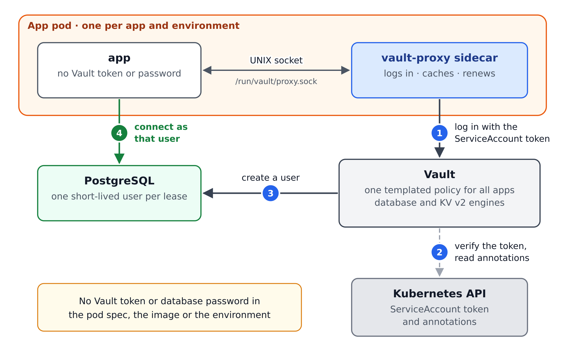

# learn-vault-proxy

A sample app on k3d gets short-lived PostgreSQL credentials from Vault Community Edition without holding any Vault
secret. It authenticates with its Kubernetes ServiceAccount through a Vault Proxy sidecar listening on a UNIX socket.
One templated policy, driven by ServiceAccount annotations, isolates each app and environment.



For the detailed architecture, see the [solution design](docs/solution-design.md).

## Prerequisites

kubectl, helm, k3d, docker or podman, jq, task, uv, pre-commit, shellcheck, gitleaks, yamllint, hadolint, ruff,
envsubst and openssl. Check them with `task deps`.

## Quick start

```bash
task init             # pre-commit hooks, Helm repo, .env, app venv
task all              # cluster, Vault CE, PostgreSQL, 3 apps, verify (about 5 min)
task demo:isolation   # cross-app and cross-environment reads are denied
task demo:revoke      # break-glass revoke; the app recovers with a new user
task logs             # follow the app's JSON logs (or use k9s)
```

After a laptop restart, run `task cluster:up && task unseal:vault`. To delete everything, run `task clean`.

## Documentation

- [Solution design](docs/solution-design.md)
- [Walkthrough and demo scenarios](docs/db-proxy-secrets.md)
- [Troubleshooting](docs/troubleshooting.md)

## License

[Mozilla Public License 2.0](LICENSE)
