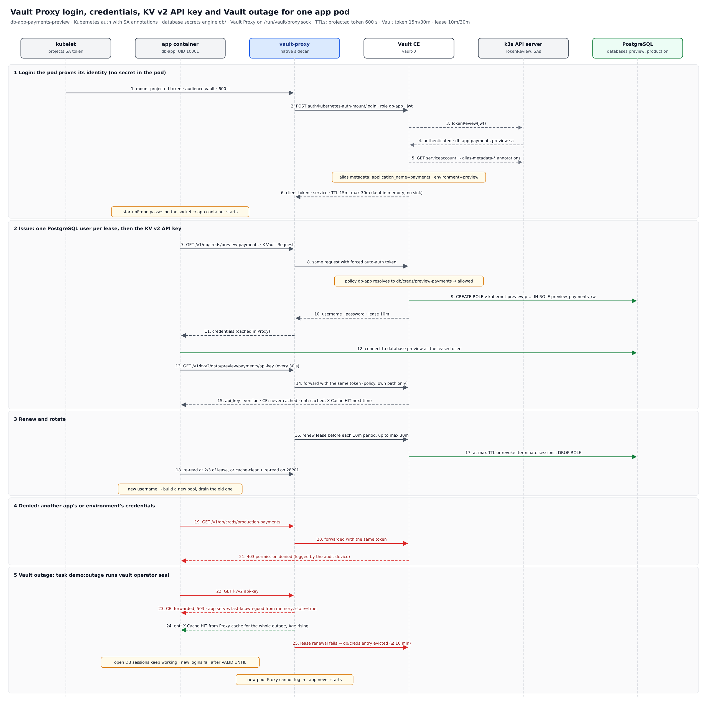

# Walkthrough: Vault Proxy and dynamic PostgreSQL credentials

Each `db-app` pod gets short-lived PostgreSQL credentials and a KV v2 API key from Vault through a Vault Proxy sidecar
on a UNIX socket. The pod holds no Vault secret. The full design is in [solution-design.md](solution-design.md).



## Build the lab

```bash
task init          # pre-commit hooks, Helm repo, .env, app venv
task all           # cluster, Vault CE, auth, PostgreSQL, db/ and kvv2/ engines, 3 apps, verify
```

A fresh run takes about 5 minutes. `task all` stops at the first failing step. Re-running it is safe.

| Step | Task | Result |
| --- | --- | --- |
| Cluster | `cluster:up` | k3d `vault-db-lab`, Vault on `localhost:8200` |
| Vault | `install` | Vault CE 2.2.1, single-node Raft, unsealed, audit to stdout |
| Identity | `config:k8s-auth` | `auth/kubernetes-auth-mount`, annotations as alias metadata, policy and role `db-app` |
| Database | `install:postgres`, `config:db-secret` | Databases `preview` and `production`, connections `pg-preview`/`pg-production`, 3 roles, admin passwords rotated |
| API keys | `config:kv-secret` | `kvv2/<environment>/<application>/api-key` per app |
| Apps | `deploy:db-app`, `verify:db-app` | 3 namespaces, annotated ServiceAccounts, app + Proxy pods |

## The three identities

| Namespace | `application_name` | `environment` | Can read |
| --- | --- | --- | --- |
| `db-app-payments-preview` | `payments` | `preview` | `db/creds/preview-payments`, `kvv2/data/preview/payments/*` |
| `db-app-checkout-preview` | `checkout` | `preview` | `db/creds/preview-checkout`, `kvv2/data/preview/checkout/*` |
| `db-app-payments-production` | `payments` | `production` | `db/creds/production-payments`, `kvv2/data/production/payments/*` |

## Watching the demo

The app writes one JSON object per line to stdout, so any log viewer shows each event as it happens.

- **k9s:** open the `db-app-*` namespace, select the pod and press `l`. Pick the `app` container for credential events
  or `vault-proxy` for Proxy logins and cache activity.
- **kubectl:** `task logs APP=db-app-payments-preview` (add `C=vault-proxy` for the sidecar), or `task logs:vault`
  for the Vault audit log.

Useful app events: `creds_acquired`, `refresh_scheduled`, `creds_rotated`, `pool_swapped`, `db_connection_lost`,
`db_login_failed`, `cache_cleared`, `vault_denied`, `kv_refreshed`, `kv_refresh_failed`, `kv_stale`.

Endpoints, through the API server's service proxy (no port-forward needed):

```bash
kubectl get --raw /api/v1/namespaces/db-app-payments-preview/services/db-app:http/proxy/whoami
kubectl get --raw /api/v1/namespaces/db-app-payments-preview/services/db-app:http/proxy/data
kubectl get --raw /api/v1/namespaces/db-app-payments-preview/services/db-app:http/proxy/apikey
kubectl get --raw "/api/v1/namespaces/db-app-payments-preview/services/db-app:http/proxy/try?path=db%2Fcreds%2Fproduction-payments"
```

## Scenarios

| # | Task | Shows |
| --- | --- | --- |
| 1, 2, 10 | `task verify:db-app` | No secret in the pod spec; each app reads its own rows and its own API key |
| 3, 4, 5, 8, 11, 16 | `task demo:isolation` | `403` for other apps and environments, audit-log denials, `permission denied for database`, RBAC blocks annotation edits, production credentials read-only on `payments.items` only |
| 6 | `task demo:rotation demo_ttl=2m` | Username changes by `max_ttl`, old role dropped (restores TTLs afterwards) |
| 7 | `task demo:revoke` | Break-glass revoke; the app recovers with a new user within seconds, other apps unaffected |
| 12 | `task demo:kv-rotate APP=db-app-payments-preview` | New API key version picked up on the next poll |
| 13, 15 | `task demo:outage outage_minutes=2` | Vault sealed: API key served from app memory (`stale=true`), DB sessions keep working; recovery after unseal |
| 14 | `task demo:outage:new-pod` | A pod restarted while Vault is sealed never becomes Ready |
| 9 | manual | `task cluster:stop`, `task cluster:up`, `task unseal:vault`, `task verify:db-app` |

`task test:all` runs the unit tests, `verify:db-app` and `demo:isolation` together.

## After a laptop restart

```bash
task cluster:up && task unseal:vault && task verify:db-app
```

Vault keeps its data on the Raft volume. It always starts sealed, and the app pods are not Ready until Vault is
unsealed.

## Tear down

```bash
task clean   # deletes the cluster and vault-init.json (asks first)
```
