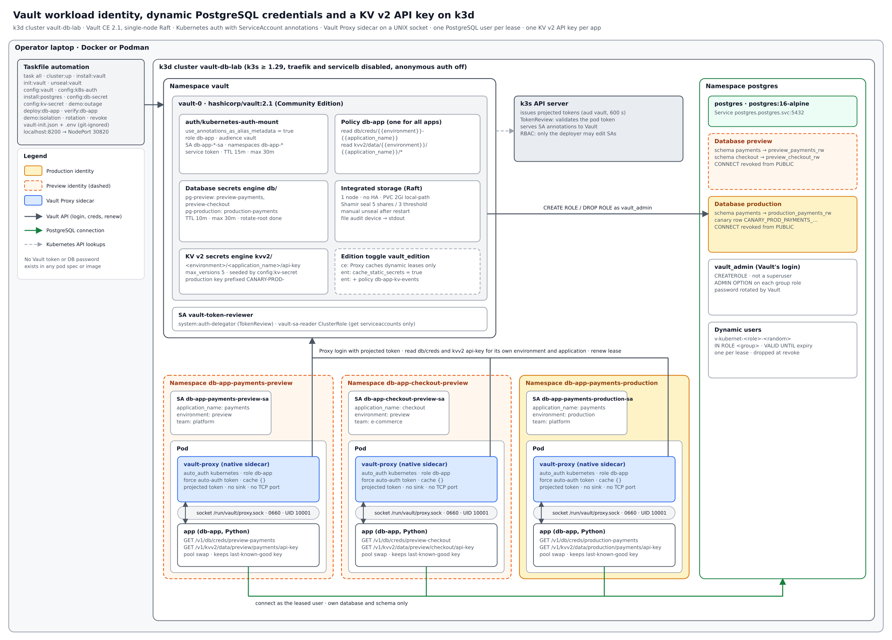
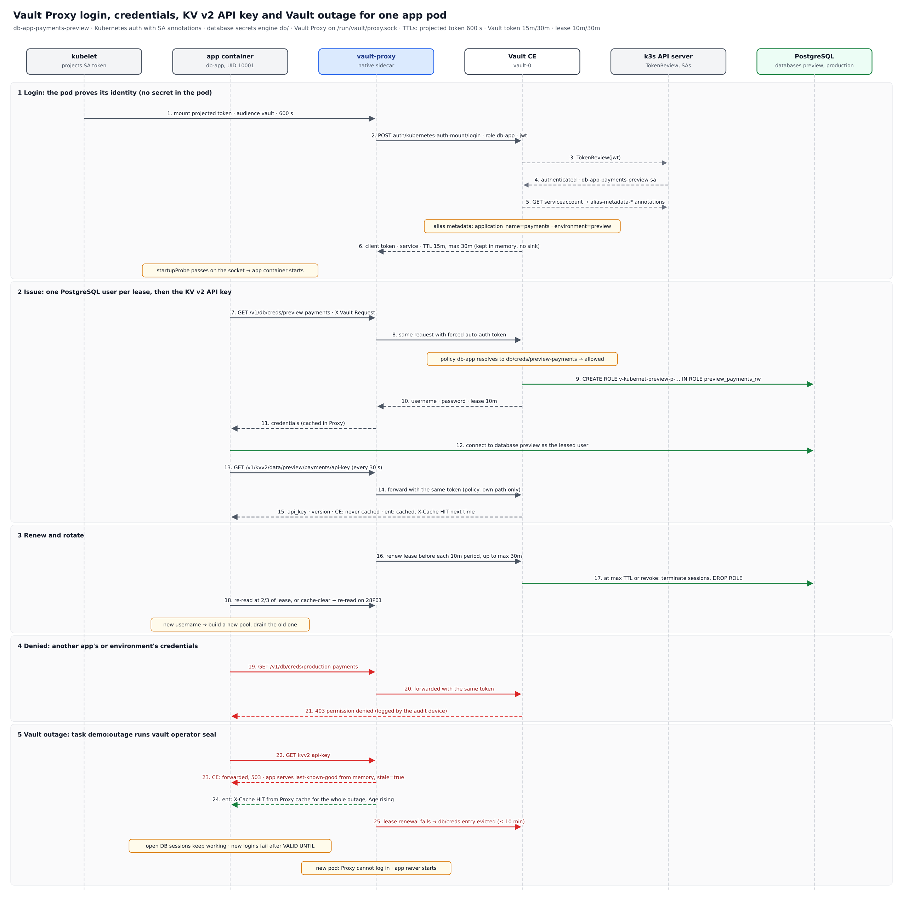

# Solution Design: Vault Workload Identity, Vault Proxy and Dynamic PostgreSQL Credentials on k3d

Nov 4, 2026 · @Narish Samplay

## 1. Executive summary

A sample app on k3d gets short-lived PostgreSQL credentials from Vault Community Edition without holding any Vault secret, and can only ever get the credentials its ServiceAccount annotations allow. The demo proves four things live: zero-secret bootstrap, per-app and per-environment isolation from one templated policy, automatic credential expiry and rotation, and break-glass revocation.

Key decisions:

- **Identity:** Vault Kubernetes auth with `use_annotations_as_alias_metadata=true`. The pod's projected ServiceAccount token (audience `vault`, 10 min) is the only bootstrap credential.
- **Authorisation:** one ACL policy templated on alias metadata grants `read` on `db/creds/<environment>-<application_name>` only. A missing annotation grants nothing.
- **Delivery:** Vault Proxy runs as a native sidecar, listens only on a UNIX socket shared with the app, forces its own auto-auth token and caches and renews the database lease. The Vault token never touches disk.
- **Credentials:** the database secrets engine issues one PostgreSQL user per lease (10 min default, 30 min max), each inheriting a pre-created group role for its own schema. A KV v2 API key per app (kvv2/data/\<environment>/\<application\_name>/api-key) exercises the static-secret path, including what happens when Vault is down.
- **Platform:** follows the k3d, Taskfile and `kubectl exec vault-0` conventions of [nhsy-hcp/learn-vault-secrets-operator](https://github.com/nhsy-hcp/learn-vault-secrets-operator), with Vault CE as a single-node Raft cluster on `localhost:8200`.

## 2. Context, goals and scope

The earlier plan ran Coder workspaces on a Proxmox k3s VM and read static KV secrets. This design moves the same identity pattern to a laptop k3d cluster, drops Coder and replaces KV with dynamic PostgreSQL credentials, which is where workload identity pays off most.

**Goals**

1. A workload authenticates with its Kubernetes identity alone: no AppRole, static token or password in the pod spec, image or environment.
2. One policy scopes every app to its own environment and application, driven by ServiceAccount annotations.
3. Database credentials are unique per lease, expire within 30 minutes and can be revoked on demand.
4. The app has no Vault login code; it calls Vault Proxy over a UNIX socket.
5. The whole demo runs from `task` targets on a single k3d cluster, rebuildable in under 10 minutes.

**In scope:** k3d, Vault CE single-node Raft, Kubernetes auth, database secrets engine (PostgreSQL), Vault Proxy sidecar, a KV v2 API key per app, a Vault outage test, an optional Enterprise toggle for Proxy static-secret caching, one sample app deployed as three identities (`payments` preview, `checkout` preview, `payments` production).

**Non-goals:** Vault Enterprise features (namespaces, Sentinel, performance standbys) beyond the optional static-secret caching toggle, HA, TLS on the Vault listener, Vault Secrets Operator, Vault Agent templates, Coder, production hardening of PostgreSQL.

## 3. Solution architecture

One k3d cluster holds Vault, PostgreSQL and three app namespaces; each app pod pairs the app with a Vault Proxy sidecar, and only Vault ever talks to PostgreSQL as an administrator.



| Component | Namespace | Role |
| --- | --- | --- |
| Vault CE `vault-0` | `vault` | Kubernetes auth, templated policy, database secrets engine, Raft storage, audit to stdout |
| `vault-token-reviewer` SA | `vault` | Lets Vault call TokenReview and read ServiceAccount annotations |
| k3s API server | control plane | Issues projected tokens, validates them, serves annotations |
| PostgreSQL | `postgres` | Databases `preview` and `production`, one group role per app schema |
| `db-app` pod (×3) | `db-app-<app>-<env>` | App container plus `vault-proxy` sidecar sharing a UNIX socket |
| Taskfile | laptop | Builds, configures and demonstrates everything; reaches Vault on `localhost:8200` |

Source images: `docs/images/architecture.png` and `docs/images/proxy-sequence.png`. The README uses a simpler,
version-free overview, `docs/images/overview.png`.

## 4. Workload identity and authentication

Each pod proves who it is with a projected ServiceAccount token; Vault validates it through the Kubernetes TokenReview API and copies the ServiceAccount's `vault.hashicorp.com/alias-metadata-*` annotations onto the entity alias.

**Identities.** One namespace and one ServiceAccount per app instance, following the repo's `pki-app-N` pattern:

| Namespace | ServiceAccount | `application_name` | `environment` | `team` |
| --- | --- | --- | --- | --- |
| `db-app-payments-preview` | `db-app-payments-preview-sa` | `payments` | `preview` | `platform` |
| `db-app-checkout-preview` | `db-app-checkout-preview-sa` | `checkout` | `preview` | `e-commerce` |
| `db-app-payments-production` | `db-app-payments-production-sa` | `payments` | `production` | `platform` |

**Auth mount.** `auth/kubernetes-auth-mount` (type `kubernetes`), configured as in the repo's `scripts/config-pki-secret.sh`:

- `kubernetes_host` = the in-cluster API address; `token_reviewer_jwt` = the long-lived token of `vault/vault-token-reviewer`, which is bound to `system:auth-delegator`.
- `use_annotations_as_alias_metadata=true`. Vault needs `get` on `serviceaccounts` for this; the repo's `vault-sa-reader` ClusterRole grants exactly that and nothing more.
- Only annotations with the `alias-metadata-` prefix are copied, each up to 512 characters. Metadata is refreshed at every login, so an annotation change takes effect on the next Proxy re-authentication.

**Role `db-app`.**

| Parameter | Value | Why |
| --- | --- | --- |
| `bound_service_account_names` | `db-app-*-sa` | Glob limits the role to the demo's naming scheme; never `*` |
| `bound_service_account_namespaces` | `db-app-*` | Same |
| `audience` | `vault` | Rejects tokens minted for the API server or other audiences |
| `alias_name_source` | `serviceaccount_uid` (default) | A deleted and recreated SA with the same name gets a new entity alias, not the old one's history |
| `token_policies` | `db-app` | The single templated policy (section 5) |
| `token_type` | `service` | Vault Proxy must renew the token and its child DB lease; batch tokens cannot be renewed |
| `token_ttl` / `token_max_ttl` | `15m` / `30m` | Keeps every Vault token under 1 hour, as the earlier plan required |

**Projected token.** Mounted only into the Proxy container at `/var/run/secrets/vault/token`, `audience: vault`, `expirationSeconds: 600`. The kubelet rotates it; Proxy re-reads the file at each login. The default ServiceAccount token is not mounted (`automountServiceAccountToken: false`), so the app container holds no Kubernetes credential at all.

**Departure from the repo:** the repo enables `anonymous-auth` on the k3s API server for its JWT auth examples. Kubernetes auth uses TokenReview instead, so this design leaves anonymous auth off.

## 5. Authorisation: one templated policy

A single policy, `db-app`, lets each token read only the database role named after its own environment and application; adding an app needs a new database role and an annotated ServiceAccount, never a new policy.

```hcl
# db-app.hcl — __ACCESSOR__ is replaced with the kubernetes-auth-mount accessor at config time
path "db/creds/{{identity.entity.aliases.__ACCESSOR__.metadata.environment}}-{{identity.entity.aliases.__ACCESSOR__.metadata.application_name}}" {
  capabilities = ["read"]
}

# KV v2 API key: same two annotations, so the same isolation applies
path "kvv2/data/{{identity.entity.aliases.__ACCESSOR__.metadata.environment}}/{{identity.entity.aliases.__ACCESSOR__.metadata.application_name}}/*" {
  capabilities = ["read"]
}
```

With `vault_edition=ent`, the Taskfile also attaches `db-app-kv-events` (appendix G). It adds the `list` and `subscribe` capabilities and the event-stream read that Proxy static-secret caching needs. CE never gets this policy, because event subscriptions are an Enterprise feature.

| Caller (from annotations) | Templated path | `db/creds/preview-payments` | `db/creds/preview-checkout` | `db/creds/production-payments` |
| --- | --- | --- | --- | --- |
| payments · preview | `db/creds/preview-payments` | allowed | denied | denied |
| checkout · preview | `db/creds/preview-checkout` | denied | allowed | denied |
| payments · production | `db/creds/production-payments` | denied | denied | allowed |

Design rules:

- **The accessor is mandatory.** Alias metadata is addressed as `identity.entity.aliases.<mount accessor>.metadata.<key>`; there is no shorthand by mount name. The Taskfile reads the accessor after enabling the mount and substitutes it with `sed`, exactly as the repo does for `pki-secret.hcl`.
- **Fail closed.** If either annotation is missing, the template cannot resolve and the path matches nothing.
- **No wildcards.** The path is exact, so `preview-payments-admin` or any other suffix is not reachable.
- **Lease renewal needs no extra grant.** Vault Proxy renews the lease with the same token, and the built-in `default` policy already allows `sys/leases/renew` and `auth/token/renew-self`.
- **Read-only, one verb.** The policy never grants `list` on `db/`, `db/config/*` or `db/roles/*`, so a compromised app cannot discover which other roles exist.

## 6. Dynamic PostgreSQL credentials

The database secrets engine at `db/` creates a new PostgreSQL login for every lease, grants it one pre-created group role, and drops it when the lease ends; no application password exists anywhere until a pod asks for one.

**PostgreSQL layout** (one instance in namespace `postgres`, `postgres:16-alpine` as in the repo):

| Database | Schema | Group role (`NOLOGIN`) | Grants |
| --- | --- | --- | --- |
| `preview` | `payments` | `preview_payments_rw` | `USAGE` on schema; `SELECT, INSERT, UPDATE, DELETE` on its tables |
| `preview` | `checkout` | `preview_checkout_rw` | Same, on `checkout` |
| `production` | `payments` | `production_payments_rw` | Same; one table holds the canary row `CANARY_PROD_PAYMENTS_NEVER_LEAK` |

Group roles own nothing; a bootstrap SQL ConfigMap creates the databases, schemas, tables, group roles and seed rows. `PUBLIC` loses `CONNECT` on both databases, so a dynamic user can only reach the database its group role is granted.

**Vault's own database logins.** Vault connects as `vault_admin_preview` for `pg-preview` and `vault_admin_production` for `pg-production`, never as the `postgres` superuser. Each login has `CREATEROLE`, `CONNECT` on its own database only and `pg_signal_backend` (to end a revoked user's sessions). Only that database's group roles are granted to it `WITH ADMIN OPTION`, which PostgreSQL 16 requires before a `CREATEROLE` user can grant a role. Straight after configuration, `vault write -f db/rotate-root/<connection>` replaces each bootstrap password with one only Vault knows. One login per connection matters: with a shared login, rotating it through one connection breaks the other. The bootstrap passwords are random, generated at install time into the `postgres-credentials` Secret.

**Connections and roles.**

| Connection (`db/config/…`) | Database | `allowed_roles` | Role (`db/roles/…`) | `default_ttl` / `max_ttl` |
| --- | --- | --- | --- | --- |
| `pg-preview` | `preview` | `preview-payments, preview-checkout` | `preview-payments`, `preview-checkout` | `10m` / `30m` |
| `pg-production` | `production` | `production-payments` | `production-payments` | `10m` / `30m` |

Creation statement, per role (group role changes per row above):

```sql
CREATE ROLE "{{name}}" WITH LOGIN PASSWORD '{{password}}' VALID UNTIL '{{expiration}}' IN ROLE preview_payments_rw;
```

Each role's `revocation_statements` terminate the user's sessions (`pg_terminate_backend`) and then drop the role. `VALID UNTIL` is a second guard: PostgreSQL itself rejects the password after expiry even if a revocation is missed. Two connections keep a preview role from ever being allowed to create users in `production`, even through a mis-set `allowed_roles`.

**Lease lifecycle.**

1. Proxy reads `db/creds/<role>` with its token; Vault returns a username, password and a 10-minute lease.
2. Proxy caches the response and renews the lease before each 10-minute period ends, up to the 30-minute `max_ttl`.
3. At `max_ttl` Vault revokes the lease and drops the user. Proxy evicts the cache entry; the app's next read mints a new user.
4. Each lease is a child of the Proxy's Vault token. When that token reaches its own 30-minute `max_ttl`, Vault revokes its leases too, so database `max_ttl` is set equal to `token_max_ttl` and never above it.
5. Break-glass: `vault lease revoke -prefix db/creds/preview-payments` drops every payments-preview user at once.

## 6a. KV v2 API key secret and Vault outage behaviour

Each app also reads a static API key from KV v2 through the same Proxy socket. This lets the demo compare a static secret with a dynamic one while Vault is unavailable. On CE the API key survives an outage only in the app's memory; on Enterprise, Proxy serves it from its cache for as long as the outage lasts.

**Mount and secrets.** KV v2 at `kvv2/` (the repo's mount name). `config:kv-secret` seeds one secret per entry in `apps.json` with a random 48-character hex key:

| Path | Fields | Readable by |
| --- | --- | --- |
| `kvv2/preview/payments/api-key` | `api_key`, `issuer=demo-partner-api`, `rotated_at` | payments · preview |
| `kvv2/preview/checkout/api-key` | same | checkout · preview |
| `kvv2/production/payments/api-key` | same; `api_key` starts `CANARY-PROD-` | payments · production |

The same templated policy (section 5) applies, so cross-app and cross-environment KV reads return `403`, exactly like `db/creds`. `max_versions=5` on the mount keeps rotation history short.

**Edition toggle.** The Taskfile variable `vault_edition` defaults to `ce`. Setting it to `ent` reuses the repo's existing Enterprise path: `hashicorp/vault-enterprise:2.1-ent` with `vault-ent/vault-license.lic`, for both the Vault server and the Proxy sidecar. It also turns on `cache_static_secrets` and attaches `db-app-kv-events`. Nothing else in the design changes; the KV v2 behaviour is identical apart from Proxy caching.

**Behaviour during a Vault outage.** The outage is simulated with `vault operator seal`, so recovery is just `task unseal:vault`.

| Request during outage | CE (`vault_edition=ce`) | Enterprise (`vault_edition=ent`) |
| --- | --- | --- |
| KV v2 read of a key already read | Fails: Proxy forwards it and Vault returns `503`. App keeps its last-known-good value in memory | Served by Proxy: `X-Cache: HIT`, `Age` header rises. Kept for the whole outage |
| KV v2 first read or list | Fails | Fails: only `GET`s already cached are served |
| `db/creds` repeat read | Served from Proxy cache until the next lease renewal fails (at most 10 min), then evicted | Same |
| Existing PostgreSQL sessions | Keep working (`VALID UNTIL` is checked only at login) | Same |
| New PostgreSQL logins | Fail once the current `VALID UNTIL` passes | Same |
| New or restarted pod | Proxy cannot log in; app never starts | Same |
| Policy revoked during the outage | Not applicable | Still served until Vault returns, because refresh behaviour is `optimistic` (`pessimistic` would cut access on any error) |

**App behaviour for KV.** The app re-reads the key every `KV_REFRESH_SECONDS` (default 30). On failure it keeps the last good value, marks it `stale`, and retries with backoff. It never returns the key itself. `/apikey` reports the KV version, a SHA-256 fingerprint (first 12 hex characters), `source` (`vault`, `proxy-cache` or `app-memory`), the `X-Cache` and `Age` headers it last saw, and seconds since the last successful refresh.

**Rotation.** `task demo:kv-rotate` writes a new version for one app. On CE the app picks it up on its next poll. On Enterprise, the KV event makes Proxy refresh its cache entry, and the app's next poll returns the new version with `X-Cache: MISS` and then `HIT`.

## 7. Vault Proxy design

Vault Proxy runs as a native sidecar in every app pod, authenticates with the pod's projected token, and is reachable only through a UNIX socket on a memory-backed volume shared with the app container.



Steps 1–6 happen once per Proxy login (every 30 minutes at most). Steps 7–12 happen once per lease, and steps 13–15 on every KV poll. Step 21 is what any cross-app or cross-environment read returns. Steps 22–25 show the outage behaviour from section 6a.

**Placement.** The Proxy is an init container with `restartPolicy: Always` (a Kubernetes native sidecar), so it starts before the app, stays up, and stops after it. A `startupProbe` runs `vault token lookup -address=unix:///run/vault/proxy.sock`, so the app container does not start until Proxy holds a valid auto-auth token. `vault status` alone passes as soon as Vault is unsealed, before Proxy has logged in. `VAULT_ADDR` must not be set in the Proxy container: it overrides `vault.address` in `proxy.hcl` and points Proxy at itself. One Proxy per pod: the docs advise one Proxy per application when `use_auto_auth_token` is on, because Vault cannot tell apart callers sharing a Proxy.

**Configuration choices.**

| Stanza | Setting | Why |
| --- | --- | --- |
| `vault` | `address = "http://vault.vault.svc.cluster.local:8200"` | In-cluster Service; plain HTTP is a demo-only exception (section 10) |
| `auto_auth.method "kubernetes"` | `mount_path = "auth/kubernetes-auth-mount"`, `role = "db-app"`, `token_path = "/var/run/secrets/vault/token"` | Reads the projected token, re-reading the file at each login |
| `auto_auth.sink` | none | The Vault token stays in Proxy memory and never touches disk |
| `api_proxy` | `use_auto_auth_token = "force"` | Every forwarded request uses the Proxy's token; a token the app sends is replaced, so a stolen token gives no extra reach through the socket |
| `cache` | empty block (dynamic caching on, static caching off) | Repeat reads return the same lease; Proxy renews it until `max_ttl`. Static-secret caching is not used |
| `listener "unix"` | `address = "/run/vault/proxy.sock"`, `socket_mode = "0660"`, `socket_user = "10001"`, `socket_group = "10001"`, `tls_disable = true`, `require_request_header = true` | No TCP port exists; only UID/GID 10001 can open the socket; requests without `X-Vault-Request: true` get `412`, which blocks blind SSRF-style relays |
| `proxy_api` | `enable_quit = false` (default) | The app cannot stop its own Proxy |

**Container security.** Both containers run as UID/GID `10001` with `runAsNonRoot`, `readOnlyRootFilesystem`, all capabilities dropped and `allowPrivilegeEscalation: false`. The socket lives on an `emptyDir` with `medium: Memory` mounted only into these two containers. The projected token volume is mounted only into the Proxy.

**What the socket does and does not protect.** It removes network exposure inside the pod and keeps other UIDs out. It does not limit the app itself: whatever runs as UID 10001 in the app container can use everything the policy allows. The templated policy is the control; the socket is defence in depth.

**Cache and out-of-band revocation.** Proxy evicts a cache entry when it sees a revocation pass through it, or when renewal fails. A revocation made directly on Vault, such as the break-glass `lease revoke -prefix`, is not seen and leaves a stale entry until the next renewal attempt fails. The app therefore calls `POST /proxy/v1/cache-clear` with `{"type": "request_path", "value": "/v1/db/creds/<role>"}` when PostgreSQL rejects its login, then reads again (section 8).

## 8. Sample application

The app is one small Python service (`db-app`, Python 3.12, `psycopg` 3, standard-library HTTP over the socket) deployed three times; its only configuration is the socket path, the Vault role path and the database host, all non-secret.

| Setting (env var) | Example | Secret? |
| --- | --- | --- |
| `VAULT_SOCKET` | `/run/vault/proxy.sock` | No |
| `DB_CREDS_PATH` | `db/creds/preview-payments` | No |
| `DB_HOST` / `DB_NAME` | `postgres.postgres.svc.cluster.local` / `preview` | No |

**Credential behaviour.**

1. On start, `GET /v1/<DB_CREDS_PATH>` over the socket with `X-Vault-Request: true`. Keep `username`, `password` and `lease_duration`.
2. Open a small connection pool with those credentials.
3. Re-read at two thirds of `lease_duration`, capped at 60 s (`CREDS_REFRESH_MAX_SECONDS`). Proxy returns the same cached lease while it is renewable. If the username changed, build a new pool, switch traffic to it and close the old one. The cap means a user dropped at `max_ttl` is replaced within about a minute.
4. On PostgreSQL error `28P01` (invalid password) or `28000`: call `POST /proxy/v1/cache-clear` for that path, read again, rebuild the pool. Retry with jittered backoff, at most 5 attempts.
5. On `403` from Vault for its own path: log `vault_denied` and retry with jittered backoff (capped at 30 s), keeping any open pool. A 403 is transient while Proxy has no token (just started, or re-authenticating after an outage). `/try` never retries: its 403 is the expected result of the isolation tests.

**Endpoints.**

| Path | Returns |
| --- | --- |
| `/healthz` | `200` when a pool is open |
| `/whoami` | `current_user`, lease ID suffix and seconds to expiry; never the password |
| `/data` | Rows from its own schema, proving the grant works |
| `/try?path=db/creds/<role>` | Demo only: tries another Vault path and returns the HTTP status, to show the denial live |

`/try` is the stand-in for a compromised or prompt-injected workload. It is disabled unless `DEMO_MODE=true`, and it returns only the status code, never credential values.

**KV v2 additions.** Two more non-secret settings, `API_KEY_PATH` (for example `kvv2/data/preview/payments/api-key`) and `KV_REFRESH_SECONDS` (default `30`), and one more endpoint, `/apikey`, which returns only the version, fingerprint, source, cache headers and staleness described in section 6a. `/try` also accepts KV paths, so the same denial can be shown for `kvv2/data/production/payments/api-key`.

## 9. Platform and Taskfile automation

Everything runs from `task`, reusing the repo's structure: `scripts/cluster-up.sh` and `cluster-ready.sh`, `kubectl exec vault-0` for configuration, `.env` plus a git-ignored `vault-init.json`, and one `config:` / `deploy:` / `verify:` task per concern.

**k3d cluster.** `task cluster:up` creates `vault-db-lab` with the repo's flags minus anonymous auth:

```bash
k3d cluster create vault-db-lab --wait=false \
  --port 8200:30820@server:0 \
  --k3s-arg "--disable=traefik,servicelb@server:0"
```

`localhost:8200` reaches Vault through NodePort `30820`. Native sidecars need Kubernetes 1.29 or later; current k3d images meet that.

**Vault CE.** Helm chart `hashicorp/vault` `0.34.1` (the repo's pin) with image `hashicorp/vault:2.2.1`, the latest Community release at build time (the repo pins `2.1-ent`). Values replace the repo's Enterprise settings:

| Value | Setting |
| --- | --- |
| `server.image.repository` | `hashicorp/vault` (no `enterpriseLicense`) |
| `server.ha.enabled` / `replicas` / `raft.enabled` / `raft.setNodeId` | `true` / `1` / `true` / `true` — integrated storage on one node, no failover |
| `server.dataStorage` | enabled, `2Gi`, `local-path` |
| `server.service` | `NodePort`, `30820` |
| `injector.enabled` / `csi.enabled` | `false` / `false` |
| `global.tlsDisable` | `true` (demo only) |

No Enterprise namespaces exist in CE, so every command drops the repo's `VAULT_NAMESPACE=tn001`. Vault uses Shamir seal: 5 key shares, threshold 3, written to `vault-init.json`. After a laptop restart, `task cluster:up` followed by `task unseal:vault` brings it back with all data intact.

**Task list.**

| Task | Does | Repo equivalent |
| --- | --- | --- |
| `prerequisites` | Checks `kubectl`, `helm`, `k3d`, `docker`/`podman`, `jq`, `task`; adds the Helm repo | `prerequisites` |
| `cluster:up` / `cluster:stop` / `cluster:down` | Creates or starts, stops, deletes the k3d cluster | Same |
| `install:vault` | Helm install of Vault CE with Raft values | `install:vault` without licence |
| `init:vault` / `unseal:vault` | Initialises once, writes `vault-init.json` and `.env`; unseals with 3 keys | Same |
| `config:vault` | File audit device to stdout; applies `vault-token-reviewer` SA, `auth-delegator` binding, token Secret and `vault-sa-reader` RBAC | `config:vault` plus `vault-sa-reader-rbac.yaml` |
| `config:k8s-auth` | Enables `kubernetes-auth-mount` with annotation metadata, reads the accessor, writes policy `db-app` and role `db-app` | `scripts/config-pki-secret.sh` pattern |
| `install:postgres` | Namespace `postgres`, PVC, Deployment, Service and the bootstrap SQL ConfigMap | `postgres-deployment.yaml.tpl` |
| `config:db-secret` | Enables `db/`, writes `pg-preview` and `pg-production`, the three roles, then `rotate-root` on both | `deploy:dynamic-secret` DB steps |
| `deploy:db-app` | Builds and imports the app image (`k3d image import`), renders one namespace, annotated SA, ConfigMap and Deployment per entry in `apps.json` | `entity-secrets` templates + `apps.json` |
| `verify:db-app` | Waits for pods, calls `/whoami` and `/data` on each | `verify:*` |
| `demo:isolation` / `demo:rotation` / `demo:revoke` | Runs the scenarios in section 11 | New |
| `clean:leases` | `vault lease revoke -prefix db/creds/` | `clean` lease step |
| `all` | `prerequisites` → `cluster:up` → `install` → `config` → `deploy` → `verify` | `all` |

**KV v2 and outage tasks.**

| Task | Does |
| --- | --- |
| `config:kv-secret` | Enables `kvv2/` (`max_versions=5`), seeds one API key per `apps.json` entry, writes `db-app-kv-events` and adds it to role `db-app` when `vault_edition=ent` |
| `demo:kv-rotate APP=<name>` | Writes a new key version for one app, then polls its `/apikey` until the new version shows |
| `demo:outage` | Prints each app's `/apikey` and `/whoami`, runs `vault operator seal`, polls both endpoints every 15 s for `outage_minutes` (default 12), then runs `unseal:vault` and shows recovery |
| `demo:outage:new-pod` | During an outage, restarts one app pod to show that a pod with no cache cannot start |

New Taskfile variables: `vault_edition` (`ce` or `ent`), `kv_refresh_seconds` (`30`), `outage_minutes` (`12`). `all` runs `config:kv-secret` straight after `config:db-secret`.

**Files added.** `vault-ce/vault-values.yaml`, `vault-ce/db-secrets/db-app.hcl`, `db-app-role.json`, `postgres-bootstrap.sql`, `templates/{namespace,service-account,deployment,proxy-config}.yaml.tpl`, `apps.json`, `app/` (Python source and Dockerfile), `scripts/config-k8s-auth.sh`, `scripts/config-db-secret.sh`, and `docs/db-proxy-secrets.md`.

## 10. Security controls and threat model

The trust boundary is Kubernetes RBAC on ServiceAccounts: Vault checks the token cryptographically, but the annotations that pick the database role are only as trustworthy as whoever may edit them.

| Threat | Control | Residual risk |
| --- | --- | --- |
| App code is compromised or tricked into reading another app's or environment's credentials | Templated policy grants one exact path; `/try` shows `403` live | The attacker can still use the app's own credentials until they expire (≤ 30 min) |
| Someone edits an SA annotation to widen scope (`environment: production`) | Annotations are read from the API server at login, not from the pod. Only the platform deployer may `patch`/`update` `serviceaccounts` in `db-app-*`; app teams and workloads get no SA write rights | Not enforced by Vault. Production should add an admission policy (Kyverno or ValidatingAdmissionPolicy) that locks `alias-metadata-*` keys to the namespace |
| Projected token stolen from the pod | Audience `vault`, 10-minute expiry, mounted only in the Proxy container, bound to the pod's lifetime | Replayable within its 10 minutes |
| Vault token stolen | No sink: it exists only in Proxy memory. `force` mode means the socket never honours a token the app supplies | A memory dump of the Proxy process |
| Another process or container in the pod uses the Proxy | No TCP listener; socket `0660` for UID/GID 10001; volume mounted only in app and Proxy | Any code running as UID 10001 |
| Request forgery through the app (SSRF) | `require_request_header = true` rejects requests without `X-Vault-Request` | An attacker who controls headers too |
| Leaked database password | One user per lease, `VALID UNTIL`, 10-minute TTL, 30-minute cap, `revoke -prefix` | Valid until revocation, at most 30 minutes |
| Vault's database admin password leaked from bootstrap | `vault_admin_preview` and `vault_admin_production` are not superusers and each reaches one database; `rotate-root` right after configuration | The random `postgres` superuser password stays in a Kubernetes Secret for the demo |
| Unseal keys or root token on the laptop | `vault-init.json` and `.env` are git-ignored, as in the repo | Demo-grade only (below) |

**KV v2 API key, compared with the dynamic credentials.** A leaked API key stays valid until someone rotates it, not for 30 minutes, so it is the weaker of the two secrets and the demo says so. On Enterprise, Proxy holds the key in memory for the life of the pod, and under `optimistic` refresh a policy revoked during an outage only takes effect once Vault returns. The trade is availability against how quickly access can be revoked. `pessimistic` reverses it.

**Demo-only shortcuts that must not carry into production:** plain HTTP on the Vault listener (`tlsDisable: true`), unseal keys and root token in a local file, root token used for configuration, `sslmode=disable` to PostgreSQL, a single Vault node and the `postgres` superuser password in a manifest. Production equivalents: TLS everywhere, auto-unseal, root token revoked after a Terraform-driven bootstrap, `sslmode=verify-full`, and a 3- or 5-node Raft cluster.

**Audit.** A file audit device writes to stdout, so `kubectl logs vault-0 -n vault` shows every login (with its role and ServiceAccount name, namespace and UID) and every `db/creds` and `kvv2` read, including denials. The `alias-metadata-*` values are stored on the entity alias, not in the audit entry; `vault read identity/entity-alias/id/<id>` shows them. Each denial in section 11 can be pointed out in the log during the demo.

## 11. Demo scenarios and acceptance criteria

The demo passes when every row below shows its expected result from a fresh `task all`, with no manual step besides answering the re-initialise prompt.

| # | Scenario | Task | Action | Expected result |
| --- | --- | --- | --- | --- |
| 1 | Zero-secret bootstrap | `verify:db-app` | Inspect pod spec and env of `db-app-payments-preview` | No Vault token, password or role ID; `/whoami` returns a user like `v-kubernet-preview-p-…` |
| 2 | Own data | `verify:db-app` | `GET /data` on each app | Rows from its own schema only |
| 3 | Cross-app read | `demo:isolation` | payments-preview `/try?path=db/creds/preview-checkout` | `403`; audit log shows the denied path |
| 4 | Cross-environment read | `demo:isolation` | payments-preview `/try?path=db/creds/production-payments` | `403`; production canary never returned |
| 5 | Database-level isolation | `demo:isolation` | With payments-preview credentials, `psql` to database `production` | Connection refused: `permission denied for database` |
| 6 | Rotation | `demo:rotation` | Watch `/whoami` for 35 minutes, or shorten TTLs with `demo_ttl=2m` | Username changes at or before `max_ttl`; old role gone from `pg_roles` |
| 7 | Break-glass revoke | `demo:revoke` | `vault lease revoke -prefix db/creds/preview-payments` | App logs `28P01`, clears its cache entry, gets a new user within 30 s; other apps unaffected |
| 8 | Annotation tampering is blocked by RBAC | `demo:isolation` | As the app-team user, `kubectl annotate sa … environment=production` | `forbidden`; no Vault change needed |
| 9 | Restart survival | manual | `task cluster:stop`, `cluster:up`, `unseal:vault` | Policies, roles and connections intact; apps recover new credentials |

KV v2 and outage scenarios:

| # | Scenario | Task | Action | Expected result (CE) | Expected result (Enterprise) |
| --- | --- | --- | --- | --- | --- |
| 10 | Own API key | `verify:db-app` | `GET /apikey` on each app | Version 1, `source=vault` | Version 1, then `source=proxy-cache`, `X-Cache: HIT` |
| 11 | Cross-app and cross-environment KV read | `demo:isolation` | `/try?path=kvv2/data/production/payments/api-key` from payments-preview | `403` | `403`, never cached |
| 12 | Rotation | `demo:kv-rotate APP=db-app-payments-preview` | New key version | Seen on next poll (≤ 30 s) | Event refreshes the cache; seen on next poll |
| 13 | Vault outage, static vs dynamic | `demo:outage` | Seal Vault for 12 min | `/apikey` keeps working only from `app-memory`, `stale=true`. `/whoami` keeps working until the lease renewal fails, then new DB logins fail | `/apikey` keeps working from `proxy-cache` the whole time, `Age` rising. `/whoami` same as CE |
| 14 | New pod during outage | `demo:outage:new-pod` | Delete one app pod while sealed | Pod stays not-ready: Proxy cannot log in | Same: the cache is per pod and starts empty |
| 15 | Recovery | `demo:outage` (end) | Unseal | Proxy re-authenticates, KV refresh and new DB leases resume within 1 min | Same; the KV cache stays warm |

The TTL variables (`db_default_ttl`, `db_max_ttl`, `token_ttl`, `token_max_ttl`) sit at the top of the Taskfile beside the repo's existing `postgresql_max_ttl`, so a short live demo can run with 2-minute leases.

## 12. Risks, assumptions and open decisions

**Assumptions**

- `hashicorp/vault:2.2.1` (verified on Docker Hub, 2026-11-05) is the pinned Community build for both server and Proxy.
- The laptop runs Docker or Podman with about 4 GB free for k3d, Vault, PostgreSQL and three app pods.
- The demo lives in its own repository, `learn-vault-proxy`, and copies and adapts the reference repo's scripts (see Changes from v1).

**Risks**

| Risk | Effect | Mitigation |
| --- | --- | --- |
| Token and lease expire together at 30 min | Every 30 min the app sees one forced credential switch | Expected and shown in scenario 6; the app's pool swap keeps requests flowing |
| Stale Proxy cache after out-of-band revocation | App retries with dead credentials | `cache-clear` on `28P01` (section 8) |
| PostgreSQL 16 `CREATEROLE` rules | Role creation fails without `ADMIN OPTION` | Bootstrap SQL grants each group role to its database's admin login `WITH ADMIN OPTION` |
| Native sidecar ordering on an older k3s image | App starts before Proxy is ready | Pin a k3s image ≥ 1.29; the app also retries the socket for 30 s |

**Open decisions**

- [ ] Add an admission policy to lock `alias-metadata-*` annotations, or keep RBAC-only for the demo?
- [ ] App language: Python as designed, or Go to ship a smaller distroless image?
- [ ] Keep Vault configuration in `kubectl exec` scripts like the repo, or add a Terraform `vault` provider stage?

## 13. Appendix: reference configuration

**A. Vault Proxy (`proxy-config.yaml.tpl`, ConfigMap key `proxy.hcl`)**

```hcl
vault {
  address = "http://vault.vault.svc.cluster.local:8200"
}

auto_auth {
  method "kubernetes" {
    mount_path = "auth/kubernetes-auth-mount"
    min_backoff = "1s"
    max_backoff = "15s"   # default grows to 5m, which delays recovery after an outage
    config = {
      role       = "db-app"
      token_path = "/var/run/secrets/vault/token"
    }
  }
}

api_proxy {
  use_auto_auth_token = "force"
}

cache {}

listener "unix" {
  address                = "/run/vault/proxy.sock"
  socket_mode            = "0660"
  socket_user            = "10001"
  socket_group           = "10001"
  tls_disable            = true
  require_request_header = true
}
```

**B. Auth role (`db-app-role.json`)**

```json
{
  "bound_service_account_names": ["db-app-*-sa"],
  "bound_service_account_namespaces": ["db-app-*"],
  "audience": "vault",
  "alias_name_source": "serviceaccount_uid",
  "token_policies": ["db-app"],
  "token_type": "service",
  "token_ttl": "15m",
  "token_max_ttl": "30m"
}
```

**C. ServiceAccount (`service-account.yaml.tpl`)**

```yaml
apiVersion: v1
kind: ServiceAccount
metadata:
  name: ${APP_NAME}-sa
  namespace: ${APP_NAME}
  annotations:
    vault.hashicorp.com/alias-metadata-application_name: ${APPLICATION}
    vault.hashicorp.com/alias-metadata-environment: ${ENVIRONMENT}
    vault.hashicorp.com/alias-metadata-team: ${TEAM}
automountServiceAccountToken: false
```

**D. Pod spec excerpt (`deployment.yaml.tpl`)**

```yaml
spec:
  serviceAccountName: ${APP_NAME}-sa
  automountServiceAccountToken: false
  securityContext: { runAsUser: 10001, runAsGroup: 10001, runAsNonRoot: true, fsGroup: 10001 }
  initContainers:
    - name: vault-proxy
      image: hashicorp/vault:2.2.1
      restartPolicy: Always          # native sidecar
      command: ["vault"]             # the image entrypoint does not know the proxy subcommand
      args: ["proxy", "-config=/etc/vault-proxy/proxy.hcl"]
      # no VAULT_ADDR env: it would override vault.address in proxy.hcl
      startupProbe:
        exec: { command: ["vault", "token", "lookup", "-address=unix:///run/vault/proxy.sock", "-format=json"] }
        periodSeconds: 2
        failureThreshold: 30
      securityContext: { readOnlyRootFilesystem: true, allowPrivilegeEscalation: false, capabilities: { drop: ["ALL"] } }
      volumeMounts:
        - { name: proxy-config, mountPath: /etc/vault-proxy, readOnly: true }
        - { name: vault-token, mountPath: /var/run/secrets/vault, readOnly: true }
        - { name: proxy-socket, mountPath: /run/vault }
  containers:
    - name: app
      image: db-app:local
      env:
        - { name: VAULT_SOCKET, value: /run/vault/proxy.sock }
        - { name: DB_CREDS_PATH, value: db/creds/${ENVIRONMENT}-${APPLICATION} }
      securityContext: { readOnlyRootFilesystem: true, allowPrivilegeEscalation: false, capabilities: { drop: ["ALL"] } }
      volumeMounts:
        - { name: proxy-socket, mountPath: /run/vault }
  volumes:
    - { name: proxy-socket, emptyDir: { medium: Memory } }
    - { name: proxy-config, configMap: { name: vault-proxy-config } }
    - name: vault-token
      projected:
        sources:
          - serviceAccountToken: { path: token, audience: vault, expirationSeconds: 600 }
```

**E. Taskfile excerpt (`config:db-secret`)**

```yaml
  config:db-secret:
    desc: Configure the database secrets engine, connections and roles
    preconditions:
      - test -f vault-init.json
    cmds:
      - kubectl exec vault-0 -n vault -- sh -c "VAULT_TOKEN=$VAULT_TOKEN vault secrets enable -path=db database" || true
      - ./scripts/config-db-secret.sh {{ .db_default_ttl }} {{ .db_max_ttl }}
    env:
      VAULT_TOKEN:
        sh: cat vault-init.json | jq -r '.root_token'
```

**F. Bootstrap SQL excerpt (`postgres-bootstrap.sql`)**

```sql
CREATE DATABASE preview;
CREATE DATABASE production;
REVOKE CONNECT ON DATABASE preview, production FROM PUBLIC;

-- :'..._password' variables are random, supplied by 00-bootstrap.sh from a Kubernetes Secret
CREATE ROLE vault_admin_preview WITH LOGIN CREATEROLE PASSWORD :'vault_admin_preview_password';
CREATE ROLE vault_admin_production WITH LOGIN CREATEROLE PASSWORD :'vault_admin_production_password';
GRANT pg_signal_backend TO vault_admin_preview, vault_admin_production;
CREATE ROLE preview_payments_rw NOLOGIN;
GRANT CONNECT ON DATABASE preview TO preview_payments_rw, vault_admin_preview;
GRANT preview_payments_rw TO vault_admin_preview WITH ADMIN OPTION;
-- repeat for preview_checkout_rw (vault_admin_preview) and production_payments_rw (vault_admin_production),
-- then per database: CREATE SCHEMA, tables, seed rows, GRANT USAGE and DML to the group role
```

**G. KV v2 seeding and the Enterprise cache toggle (`scripts/config-kv-secret.sh`, excerpt)**

```bash
vault_cmd secrets enable -path=kvv2 kv-v2 2>/dev/null || true
vault_cmd write kvv2/config max_versions=5
for row in $(jq -c '.[]' "${APPS_FILE}"); do
  app=$(jq -r .application_name <<<"$row"); env=$(jq -r .environment <<<"$row")
  prefix=$([ "$env" = production ] && echo CANARY-PROD- || echo "")
  vault_cmd kv put "kvv2/${env}/${app}/api-key" \
    api_key="${prefix}$(openssl rand -hex 24)" issuer=demo-partner-api rotated_at="$(date -u +%FT%TZ)"
done
if [ "${VAULT_EDITION}" = ent ]; then
  sed "s/__ACCESSOR__/${accessor}/g" vault-ce/db-secrets/db-app-kv-events.hcl | vault_cmd policy write db-app-kv-events -
  vault_cmd write auth/kubernetes-auth-mount/role/db-app token_policies=db-app,db-app-kv-events
fi
```

`db-app-kv-events.hcl` (Enterprise only, follows the repo's `entity-secret.hcl`):

```hcl
path "kvv2/data/{{identity.entity.aliases.__ACCESSOR__.metadata.environment}}/{{identity.entity.aliases.__ACCESSOR__.metadata.application_name}}/*" {
  capabilities          = ["read", "list", "subscribe"]
  subscribe_event_types = ["kv*"]
}
path "sys/events/subscribe/kv*" {
  capabilities = ["read"]
}
```

Proxy `cache` block when `vault_edition=ent`. On CE it stays `cache {}`.

```hcl
cache {
  cache_static_secrets                           = true
  static_secret_token_capability_refresh_interval = "5m"
  static_secret_token_capability_refresh_behavior = "optimistic"
}
```

Read KV through the socket with `vault read kvv2/data/...` or plain HTTP, not `vault kv get`. `kv get` first calls `sys/internal/ui/mounts`, which fails while Vault is down even when the secret is cached.
## 14. Changes from v1

Implementation review on 2026-11-05 made these changes.

| # | Area | Change | Why |
| --- | --- | --- | --- |
| 1 | Repository | Standalone repo `learn-vault-proxy`; `cluster-up.sh`, `cluster-ready.sh` and the `vault_cmd()` helper are copied and adapted, without `VAULT_NAMESPACE` | The reference repo is not modified |
| 2 | Versions | k3s pinned to `rancher/k3s:v1.36.6-k3s1`; Vault CE pinned to `hashicorp/vault:2.2.1` | Native sidecars need ≥ 1.29; `2.1` was a floating tag |
| 3 | Scenario 5 | The task reads a payments-preview credential with the root token, runs `psql` to `production` inside the postgres pod, expects `permission denied for database`, then revokes the lease | The app never exposes its password |
| 4 | Scenario 8 | An `app-team` Role and RoleBinding in each `db-app-*` namespace (read-only `get`/`list`/`watch` on pods, pod logs, services, configmaps, events, ServiceAccounts, deployments and replicasets; no writes of any kind), exercised with `kubectl --as=app-team` | The scenario needs a concrete identity; annotations stay RBAC-only (no admission policy) |
| 5 | App: revoke | On connection loss (`57P01` when Vault terminates sessions) the app reconnects; if login then fails with `28P01`/`28000` it calls `cache-clear` and re-reads | Revocation kills sessions before any password error |
| 6 | Proxy container | Memory `emptyDir` mounted at `/tmp` | Keeps `readOnlyRootFilesystem` safe if Proxy writes temp files |
| 7 | Taskfile | Standard tasks `init`, `deps`, `up`, `down`, `clean`, `lint`, `test`, `test:all`, `test:ci`, `build` wrap the design's tasks | Consistent task interface |
| 8 | Env file | `.env.template` instead of `.env.example` | House convention |
| 9 | Enterprise toggle | Deferred to a final optional phase; licence at `vault-ent/vault-license.lic` in this repo, git-ignored | CE is built and verified first |
| 10 | Diagrams | PNGs in `docs/images/`; no `.drawio` sources. The README overview is a separate, version-free PNG | Exported from the original design doc; the overview stays low-maintenance |
| 11 | Tests | pytest unit tests for lease refresh, pool swap, `403`, `28P01` and KV staleness against a fake UNIX-socket server | The design had acceptance scenarios only |
| 12 | App client | Python stdlib HTTP over the UNIX socket; no `hvac` | No Vault client library or login code in the app |
| 13 | Database admin logins | One admin login per connection (`vault_admin_preview`, `vault_admin_production`) instead of a shared `vault_admin`; random bootstrap passwords in the `postgres-credentials` Secret | Seen live: `rotate-root` on `pg-preview` changed the shared password and `pg-production` failed with `28P01`. Per-database logins also stop a preview admin from granting production roles |
| 14 | Revocation | Explicit `revocation_statements`: `pg_terminate_backend` for the user's sessions, then `DROP ROLE IF EXISTS` | Makes session termination on revoke deterministic (the admin logins hold `pg_signal_backend`) |
| 15 | Proxy container | `command: ["vault"]` and the probe uses `-address=unix://…`, with no `VAULT_ADDR` env | Seen live: the image entrypoint rejects `proxy` (`exec: proxy: not found`), and `VAULT_ADDR` overrode `vault.address`, so Proxy forwarded to its own socket and hung |
| 16 | Proxy startup probe | `vault token lookup` through the socket instead of `vault status` | Seen live: after an unseal, `vault status` passed before Proxy had logged in, so the app's first read was forwarded without a token, got `403` and treated it as permanent |
| 17 | Proxy auto-auth backoff | `min_backoff = "1s"`, `max_backoff = "15s"` | Seen live: after a 2-minute seal the default backoff kept a new pod from logging in for over 3 minutes |
| 18 | Secret handling in scripts | The root token, unseal keys, reviewer JWT, admin bootstrap passwords and demo DB passwords go to `kubectl exec` on stdin (`IFS= read -r`, `key=-`, `password=-`, `token_reviewer_jwt=-`), never as arguments | Arguments show up in `ps` on the laptop and inside the pod, and in the API-server exec URL |
| 19 | Lint | `task lint` adds `gitleaks git` over the full history | The pre-commit gitleaks hook scans only staged changes, so `pre-commit run --all-files` checked nothing |
| 20 | App resilience | A 403 on the app's own path retries with backoff instead of stopping; truncated Proxy responses become transport errors; background loops never exit; refresh capped at 60 s and `fetched_at` kept for an unchanged lease | Review findings: Proxy in `force` mode forwards token-less requests while it re-authenticates, and a cached body always reports the full `lease_duration` |
